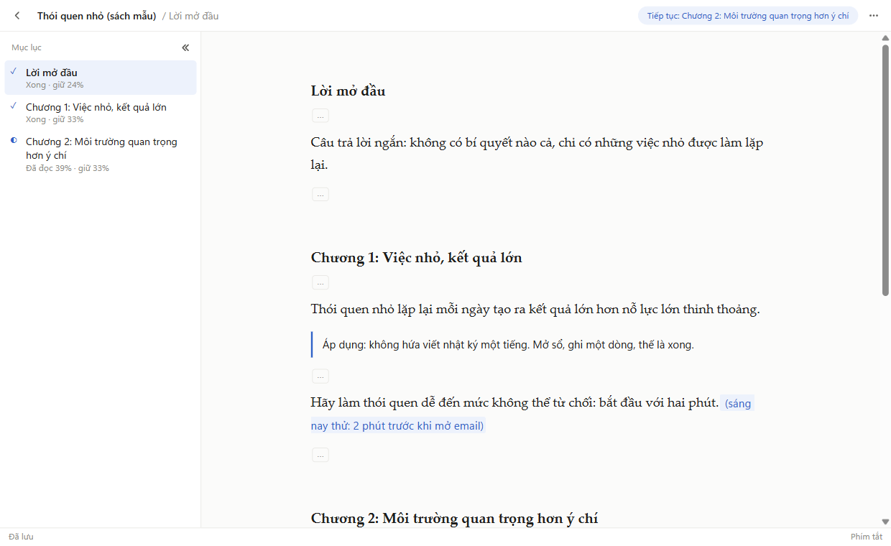
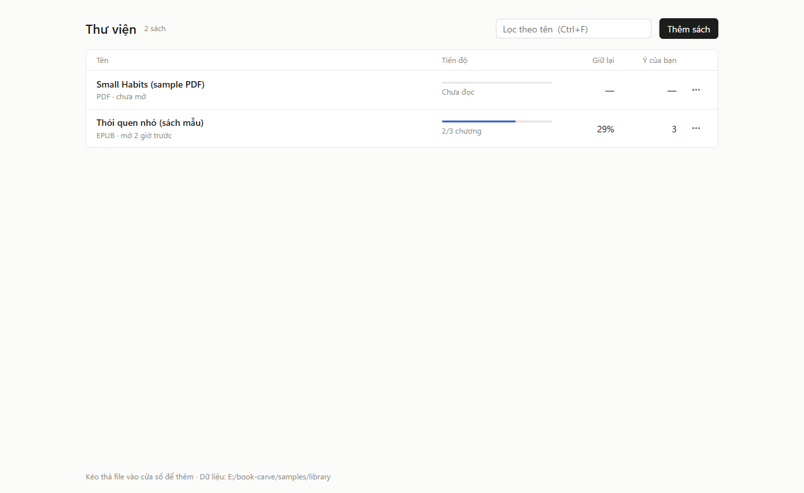
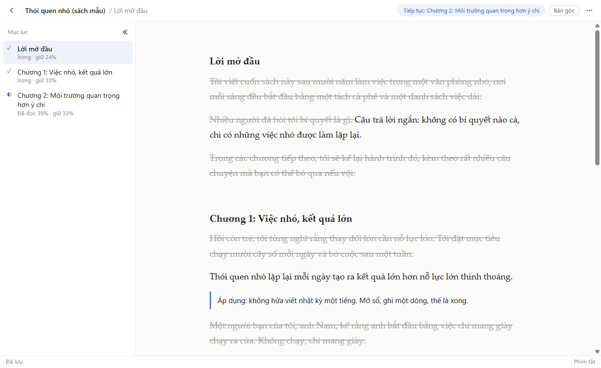

# Book Carve

**A reader that treats books as raw material, not scripture.** Delete what you don't
need, write your own ideas straight into the page, and come back to a book that is
only the part worth keeping.



Most non-fiction books carry a few ideas inside a lot of packaging. Book Carve lets
you skim, cut the packaging away like lines in your own draft, and write how each idea
applies to your work, right where it appears. The original is never touched: one
shortcut shows everything again, struck through.

Read the full idea and the research behind it in [docs/idea.md](docs/idea.md).

## What it does

- **Edit the book like a document.** Click to place a caret. Backspace hides a
  character, Ctrl+Backspace a word, a selection a whole passage. Short cuts simply
  vanish; longer ones leave a small ⋯ you can click to peek.
- **Write into the page.** Typing adds your own text inline at the caret; Enter starts
  a paragraph of your own. Your words are the only colored text on the page.
- **One continuous document.** The whole book in order, with a collapsible table of
  contents that shows what you read and how much you kept. Chapters you never opened
  fold to one line.
- **Find it again fast.** Ctrl+F searches only kept text and your own writing,
  ignoring Vietnamese diacritics.
- **Progress saves itself.** Pages for PDF, percentage for EPUB, "done" when a
  chapter's end has been on screen, and a "continue" button back to where you stopped.
- **Nothing is lost.** Every edit is an overlay with undo/redo. The original file is
  stored with the book, and re-parsing it later keeps your work.
- **Always at hand.** A small floating button above all windows opens and hides the
  reader.
- **Export** your carved version of a book to Markdown.

| Library | Original view (Ctrl+O) |
|---|---|
|  |  |

Supports EPUB and PDFs with a text layer (scanned PDFs are not supported). The
interface is in Vietnamese.

## Keys

| Key | Action |
|---|---|
| Backspace / Delete | Hide the character before / after the caret (or the selection) |
| Ctrl+Backspace / Ctrl+Delete | Hide a word |
| Typing | Write your own text at the caret |
| Enter | Start your own paragraph below |
| Right-click | Restore hidden text in the selection, or delete your own text |
| Ctrl+Z / Ctrl+Y | Undo / redo |
| Ctrl+O | Carved view ↔ original view |
| Ctrl+B | Show / collapse the table of contents |
| Ctrl+F | Search kept text and your own text |

## Install

Windows, built from source (Node 22+ and pnpm 10):

```bash
pnpm install
pnpm dist      # installer: release/Book Carve Setup <version>.exe
```

Or run it without installing:

```bash
pnpm install
pnpm app       # desktop app in development mode
pnpm dev       # browser-only version at http://localhost:5180 (data in IndexedDB)
```

`pnpm samples` writes a sample EPUB and PDF to `samples/` to try it out.

## Your data

Everything is plain files, by default in `Documents\BookCarve`:

```
books/<id>/meta.json          title, format, chapter count
books/<id>/book.json          parsed text (never changed after import)
books/<id>/annotations.json   cuts, your own text, progress
books/<id>/source.epub|pdf    the original file
books/<id>/book.prev.json     the previous parse, after a re-parse
```

To keep the library elsewhere (a synced folder, another drive), put
`{ "dataDir": "D:\\Books\\BookCarve" }` in `%APPDATA%\Book Carve\config.json`, or set
the `BOOK_CARVE_DATA` environment variable. Writes are atomic; deleting a book moves
its folder to the Recycle Bin.

## How it works

Electron app with a Vite + React 19 + TypeScript renderer.

- **Import** (`src/import`). EPUB is unzipped with JSZip; each spine file becomes a
  chapter, titled from the nav/NCX contents. PDF text comes from pdf.js and is rebuilt
  into paragraphs from line geometry: gaps, indentation, short last lines, list
  markers, running headers and footers dropped, paragraphs joined across page breaks.
  Bookmarks become chapters.
- **Overlay model** (`src/lib`). A chapter is a list of text blocks with character
  offsets. Cuts are merged `[start, end)` ranges; your own text is anchored at an
  offset or after a block. The parsed text itself never changes.
- **Editor** (`src/book`). The reading surface is `contentEditable`, but book text is
  never edited in the DOM: every `beforeinput` on it is turned into a model change
  (hide a range, create your own text) and the caret is put back. Your own text is
  edited natively and synced back. Input-method composition (Vietnamese IME) is
  handled at `compositionend`.
- **Re-parse** (`src/lib/remap.ts`). Rebuilds a book from its stored original with
  the current parser and moves cuts, notes and progress over by finding their
  surrounding text (whitespace-insensitive anchors), then reports what moved.
- **Desktop shell** (`electron/`). The main process owns the disk. The renderer
  talks to it only through a sandboxed preload bridge, sending ids and JSON, never
  paths.

```bash
pnpm test      # unit tests (Vitest)
pnpm smoke     # end-to-end run of the built app (Playwright + Electron)
```

## License

[AGPL-3.0](LICENSE). Made by [@Hoang993007](https://github.com/Hoang993007).
